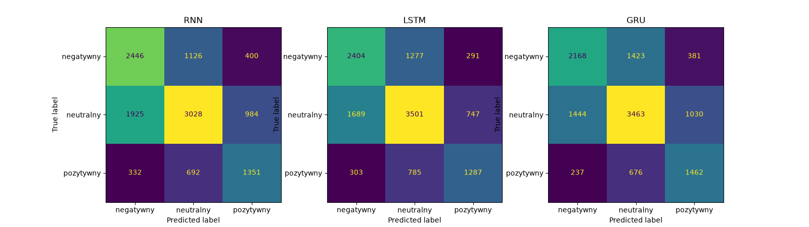

# Raport – analiza sentymentu RNN, LSTM i GRU

Kod, trening i wszystkie wyniki są w notatniku `sentiment_bot.ipynb`.

## Dane i przygotowanie

- **Zbiór:** [TweetEval – sentiment](https://huggingface.co/datasets/cardiffnlp/tweet_eval), czyli angielskie tweety z 3 klasami: negatywny, neutralny i pozytywny.
- **Podział:** gotowy podział zbioru. Train ma 45 615 tweetów, validation 2 000, a test 12 284. Test jest wspólny dla wszystkich modeli.
- **Tokenizacja:** `TweetTokenizer` z NLTK (małe litery, skracanie `soooo` → `sooo`, usuwanie `@user`). Emotikony zostają jako osobne tokeny.
- **Kodowanie:** słownik zbudowany z treningu ma 20 002 słowa (słowa występujące co najmniej 2 razy, `<pad>` = 0, `<unk>` = 1). Każdy tekst to 40 indeksów z paddingiem z lewej strony.

| Klasa | train | validation | test |
| --- | --- | --- | --- |
| negatywny | 7 093 | 312 | 3 972 |
| neutralny | 20 673 | 869 | 5 937 |
| pozytywny | 17 849 | 819 | 2 375 |

## Modele i trening

Wszystkie modele mają tę samą budowę:

- Embedding (100);
- warstwa rekurencyjna `nn.RNN`, `nn.LSTM` albo `nn.GRU` (128 neuronów);
- Dropout 0.3;
- warstwa liniowa z 3 wyjściami.

Trening:

- Adam, lr = 0.001, batch 64, 8 epok;
- CrossEntropyLoss z wagami klas, bo klasa negatywna jest najrzadsza;
- przycinanie gradientu do 1.0;
- trening na CPU z `torch.manual_seed(42)`.

Zapisywane są wagi z epoki o najlepszym macro F1 na walidacji (`models/*.pt`).

## Wyniki na zbiorze testowym

Precision, Recall i F1 to średnie makro. Czas predykcji to średni czas jednej wiadomości razem z tokenizacją (CPU, Apple Silicon).

| Model | Accuracy | Precision | Recall | F1 | Trening [s] | Predykcja [ms] |
| --- | --- | --- | --- | --- | --- | --- |
| RNN | 0.556 | 0.546 | 0.565 | 0.551 | 32 | 0.18 |
| **LSTM** | **0.585** | **0.577** | 0.579 | **0.577** | 96 | 0.39 |
| GRU | 0.577 | 0.565 | **0.582** | 0.571 | 80 | 0.36 |

### Macierze pomyłek

## Eksperymenty

Macro F1 w poszczególnych grupach zbioru testowego. Kolumna „zgodność” to odsetek wiadomości, dla których wszystkie trzy modele dały ten sam wynik.

| Grupa | Liczba | RNN | LSTM | GRU | Zgodność |
| --- | --- | --- | --- | --- | --- |
| cały test | 12 284 | 0.551 | 0.577 | 0.571 | 0.602 |
| krótkie (≤ 10 tokenów) | 2 456 | 0.540 | 0.571 | 0.569 | 0.631 |
| długie (≥ 25 tokenów) | 1 514 | 0.517 | 0.548 | 0.569 | 0.567 |
| z negacją | 2 172 | 0.470 | 0.492 | 0.501 | 0.613 |
| z emotikonami | 587 | 0.501 | 0.533 | 0.553 | 0.566 |
| ze slangiem | 454 | 0.550 | 0.559 | 0.566 | 0.593 |

### Zgodność modeli

- Wszystkie trzy modele dają ten sam wynik w **60.2%** wiadomości testowych. Wtedy accuracy wynosi **0.659**.
- Gdy modele się różnią, accuracy spada do 0.400 (RNN), 0.475 (LSTM) i 0.455 (GRU).

### Własne przykłady

| Tekst | Oczekiwany | RNN | LSTM | GRU |
| --- | --- | --- | --- | --- |
| I love this phone | pozytywny | pozytywny (86%) | pozytywny (88%) | pozytywny (96%) |
| I don't love this phone | negatywny | ❌ pozytywny (75%) | ❌ pozytywny (74%) | ❌ pozytywny (91%) |
| This is not bad at all | pozytywny | ❌ negatywny (75%) | ❌ negatywny (92%) | ❌ negatywny (80%) |
| This is not good | negatywny | negatywny (70%) | negatywny (79%) | negatywny (89%) |
| Best day ever :) | pozytywny | pozytywny (98%) | pozytywny (98%) | pozytywny (99%) |
| Great, another Monday :( | negatywny | negatywny (68%) | negatywny (71%) | negatywny (63%) |
| omg yesss 😍😍 | pozytywny | pozytywny (76%) | pozytywny (54%) | pozytywny (83%) |
| ugh this sucks smh | negatywny | negatywny (98%) | negatywny (98%) | negatywny (100%) |
| lol that party was lit | pozytywny | pozytywny (59%) | pozytywny (65%) | pozytywny (70%) |
| The meeting is moved to 5pm on Friday | neutralny | neutralny (55%) | neutralny (77%) | neutralny (77%) |
| ok | neutralny | neutralny (65%) | ❌ pozytywny (55%) | neutralny (49%) |

## Przykłady klasyfikacji (najlepszy model: LSTM)

Poprawne:

| Tekst | Klasa | Pewność |
| --- | --- | --- |
| @user @user That's coming, but I think the victims are going to be Medicaid recipients. | neutralny | 0.44 |
| I think I may be finally in with the in crowd #mannequinchallenge #grads2014 @user | pozytywny | 0.73 |
| How many more days until opening day? 😩 | neutralny | 0.50 |
| All CSG and Fracking all around Australia is to cease and Mining Entities held Accountable! - Sign the Petition! | neutralny | 0.41 |

Błędne (model był najbardziej pewny siebie):

| Tekst | Prawdziwa | Przewidziana | Pewność |
| --- | --- | --- | --- |
| Love is love. No room for hate! @user from @user ... | neutralny | pozytywny | 0.99 |
| Oh Happy Day, Conservatives Laugh As LiberalsCry And All Their Dreams Fade Away @user | neutralny | pozytywny | 0.99 |
| I liked a @user video Sports Illustrated Swimsuit Cover Model Ashley Graham | neutralny | pozytywny | 0.99 |
| Yes, yes, yes! A billion times yes. So say my daughters with autism who could lose their coverage of therapy. #ACA… | neutralny | pozytywny | 0.99 |

## Wnioski

1. **Najlepszy jest LSTM** (F1 0.577), GRU jest prawie tak samo dobry (0.571), a RNN najsłabszy (0.551). Wszystkie modele najczęściej mylą klasę neutralną z negatywną.
2. **Czas:** RNN trenuje się około 3 razy szybciej i przewiduje około 2 razy szybciej niż LSTM i GRU. Każda predykcja trwa jednak poniżej 1 ms, więc w bocie różnicy nie widać.
3. **Długie wiadomości:** RNN i LSTM tracą najwięcej, a GRU utrzymuje poziom. Zwykły RNN gorzej pamięta początek długiego tekstu (zanikający gradient).
4. **Negacje są najtrudniejsze** (F1 około 0.47–0.50). Sieci patrzą głównie na pojedyncze słowa, więc „I don't love…” i „not bad at all” są źle oceniane przez wszystkie modele.
5. **Emotikony i slang:** proste przykłady (`:)`, `:(`, 😍, *lol*, *smh*) są rozpoznawane. Grupa z emotikonami w teście jest jednak trudniejsza niż cały zbiór, a najlepiej radzi sobie z nią GRU.
6. **Zgodność:** gdy wszystkie trzy modele się zgadzają, wynik jest dużo bardziej wiarygodny (0.66 wobec 0.40–0.48). Modele częściej się różnią przy długich wiadomościach i tych z emotikonami.
7. **Ograniczenia:** etykiety w zbiorze bywają dyskusyjne, a modele nie rozumieją sarkazmu i działają tylko dla języka angielskiego.
